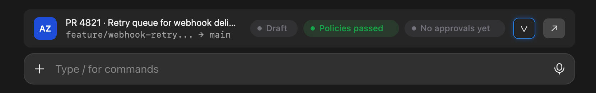

<div align="center">

# pr-snackbar

**A pull request status bar for Claude Code, for GitLab and Azure DevOps.**

The bar the Claude Code app shows for GitHub PRs, for the code hosts it doesn't cover.

[](LICENSE)
[](#install)
[](#gitlab)
[](#azure-devops)

[Install](#install) · [Requirements](#requirements) · [What it shows](#what-it-shows) · [How it works](#how-it-works) · [Troubleshooting](#troubleshooting)

</div>

---

You ask Claude to push and open a merge request. Then you switch to the browser to see whether the pipeline passed, who still has to approve, and whether `main` moved on. **pr-snackbar keeps all of that above your prompt**, and when something breaks it hands the fix straight back to Claude.

<p align="center">
  
</p>

## Highlights

- **Zero config.** It reads the host from your git remote and uses the CLI you're already signed in to. No tokens to paste, no settings.
- **Speaks each host's language.** Pipelines and approval rules on GitLab, branch policies and required reviewers on Azure DevOps, *Merge* vs *Complete*.
- **One button for the next step.** Fix a red pipeline, rebase over conflicts or merge, depending on where the MR/PR is.
- **Details on demand.** The chevron opens every pipeline job or policy, with its time, and every reviewer's vote.
- **Self-managed GitLab works.** Any host with `gitlab` in its name is recognised; list others in the **Extra GitLab hosts** setting.
- **Quiet.** Nothing shows outside a GitLab or Azure DevOps repo, or when your branch has no MR/PR.

## Requirements

| | What | Why |
| --- | --- | --- |
| **Required** | [Claude Code](https://claude.com/claude-code) with mod support, in the terminal or the desktop app | Runs the mod. Built and tested on 2.1.306 and 2.1.309. Mods are early access, so the API may change between releases. |
| **Required** | [`git`](https://git-scm.com/) | Finds the remote and the current branch. |
| **For GitLab** | [GitLab CLI (`glab`)](https://gitlab.com/gitlab-org/cli), signed in | Reads the merge request, pipeline jobs and approvals, and merges. |
| **For Azure DevOps** | [Azure CLI (`az`)](https://learn.microsoft.com/cli/azure/install-azure-cli) with the [`azure-devops` extension](https://learn.microsoft.com/azure/devops/cli/), signed in | Reads the pull request, branch policies and reviewers, and completes. |
| Platform | macOS, Linux or Windows | Tested on macOS. Linux and Windows are supported but not yet tested. On Windows, the Azure CLI (`az.cmd`) is started through `cmd /c`, and the ↗ button opens the browser with `rundll32`. |

You only need the CLI for the host you use.

### GitLab

```bash
# macOS
brew install glab
```

Other platforms: see the [glab install guide](https://gitlab.com/gitlab-org/cli#installation).

```bash
glab auth login
```

For a self-managed instance, add `--hostname gitlab.example.com`. If its hostname doesn't contain `gitlab`, add it to the **Extra GitLab hosts** setting (comma-separated, e.g. `git.example.com`). In a terminal session it's in `/config`, and a terminal install asks for it. The desktop app has no `/config`, so set it from a shell instead (it applies to the app too):

```bash
echo '{"gitlabHosts": "git.example.com"}' | claude plugin configure pr-snackbar@pr-snackbar --values-stdin
```

Use a token with the **`api`** scope if you want the Merge button; **`read_api`** is enough for status only.

Check it works from inside your repository:

```bash
glab mr view
```

### Azure DevOps

```bash
# macOS
brew install azure-cli
```

Other platforms: see the [Azure CLI install guide](https://learn.microsoft.com/cli/azure/install-azure-cli).

```bash
az extension add --name azure-devops
```

```bash
az login
```

Prefer a personal access token? Use `az devops login --organization https://dev.azure.com/<your-org>` instead. Give the token **Code (Read & write)** so Complete works too.

The organization, project and repository are detected from the git remote, so nothing else needs configuring. Check it works from inside your repository:

```bash
az repos pr list --detect true --output table
```

## Install

At the prompt of a terminal Claude Code session:

```
/plugin install pr-snackbar --marketplace pstarostka/pr-snackbar
```

Answer `y` to add the marketplace, then pick a scope. User scope turns the mod on in every session.

From a shell:

```bash
claude plugin install pr-snackbar --marketplace pstarostka/pr-snackbar
```

**Desktop app:** click **+** next to the prompt box → **Plugins** → **Add marketplace**, enter `pstarostka/pr-snackbar`, then **Add plugin**.

Then open a session in a repository whose current branch has an open MR/PR. The bar appears within a few seconds.

## What it shows

### Status chips

| | GitLab | Azure DevOps |
| --- | --- | --- |
| Checks | `Pipeline running` · `Pipeline passed` · `Pipeline failed · <job>` · `Pipeline waiting · <manual job>` · `Pipeline canceled` · `Pipeline skipped` | `Policies running · 2/4` · `Policies passed` · `Policies failed · <policy>` |
| Sign-off | `1 of 2 approvals` · `Approved` | `1 of 2 required reviewers` · `Approved` · `Waiting for author` · `Rejected` |
| Blockers | `Conflicts with <target>` · `Draft` | `Conflicts with <target>` · `Draft` |

Colours follow the status: green for done, amber for in progress, red for blocking, grey for waiting.

### The button

| When | Button | What happens |
| --- | --- | --- |
| The pipeline or build validation failed | **Fix with Claude** | Sends Claude a message, visible in the chat, to read the failing log, fix the cause and push. |
| The branch conflicts with its target | **Resolve with Claude** | Asks Claude to rebase onto the target, resolve the conflicts, run the tests and push. |
| Green and approved (GitLab: mergeable) | **Merge** / **Complete** | Runs `glab mr merge` or `az repos pr update --status completed` **right away, without confirming**. A toast says how it went. |
| Anything else | none | Only the chevron and ↗ show. |

### The details panel

Click the chevron to open it:

- **GitLab:** every job of the head pipeline with its status and duration, plus the reviewers and who approved.
- **Azure DevOps:** every branch policy (build validations, comment requirements, work item linking) with its status and run time, plus each reviewer's vote. Optional policies are listed too, but only blocking ones hold back **Complete**.

## How it works

```
git remote get-url origin
        │
        ├─ dev.azure.com · ssh.dev.azure.com · *.visualstudio.com ──▶ Azure DevOps
        ├─ any host containing "gitlab", or in Extra GitLab hosts ──▶ GitLab
        └─ anything else (GitHub included) ─────────────────────────▶ no bar
```

| | GitLab | Azure DevOps |
| --- | --- | --- |
| Find the MR/PR for this branch | `glab mr view -F json`, else `glab mr list --source-branch <branch> --all -F json` | `az repos pr list --source-branch <branch> --status all --detect true` (the active PR, else the newest) |
| Approvals / policies | `glab api projects/:id/merge_requests/<iid>/approvals` | `az repos pr policy list --id <id> --detect true` |
| Pipeline jobs | `glab api projects/:id/pipelines/<id>/jobs` | (part of the policies) |
| Merge / Complete | `glab mr merge <iid> --yes` | `az repos pr update --id <id> --status completed` |

It refreshes **every 60 seconds** and **right after each Claude turn**, because that is usually when Claude pushed. Everything runs locally through your own CLIs. The mod makes no network calls of its own and stores no credentials.

GitHub repositories are left alone on purpose: the Claude Code app already has a bar for them.

## Troubleshooting

<details>
<summary><b>The bar doesn't show up</b></summary>

1. The bar only shows for an MR/PR whose source branch is the branch you're on. A merged, completed, abandoned or closed one stays on the bar with a chip saying so and no action button, like the app's GitHub bar.
2. Run the check command for your host from the repository (`glab mr view` or `az repos pr list --detect true`). If it fails or asks you to sign in, the bar can't read it either.
3. Check `git remote get-url origin` points at GitLab or Azure DevOps. The bar only looks at the `origin` remote.
4. For self-managed GitLab: the hostname must contain `gitlab` or be listed in **Extra GitLab hosts**, and `glab` must be signed in to that host.

</details>

<details>
<summary><b>Azure DevOps: "Please run 'az login'" or nothing appears</b></summary>

Run `az login`, or set a PAT with `az devops login`. Make sure the extension is installed: `az extension list --query "[].name"` should include `azure-devops`.

</details>

<details>
<summary><b>Merge / Complete failed</b></summary>

The toast shows the CLI's error. Common causes: the token lacks write access (`api` scope for GitLab, Code (Read & write) for Azure DevOps), or the host's own rules still block the merge.

</details>

<details>
<summary><b>The ↗ button does nothing in the desktop app</b></summary>

It tries `open` (macOS), `xdg-open` (Linux) and `rundll32 url.dll,FileProtocolHandler` (Windows) in turn. If none works, a toast shows the link to open yourself.

</details>

## Development

```bash
git clone https://github.com/pstarostka/pr-snackbar
```

```bash
claude --plugin-dir ./pr-snackbar
```

```bash
claude plugin validate ./pr-snackbar
```

```bash
claude plugin test ./pr-snackbar
```

The host logic (detection and parsing each CLI's JSON) lives in [`hooks/hosts.ts`](hooks/hosts.ts), the bar in [`hooks/register.tsx`](hooks/register.tsx). Tests sit next to them.

Pull requests are welcome, especially for Bitbucket, Gitea or Forgejo.

## License

[MIT](LICENSE) © Patryk Starostka
